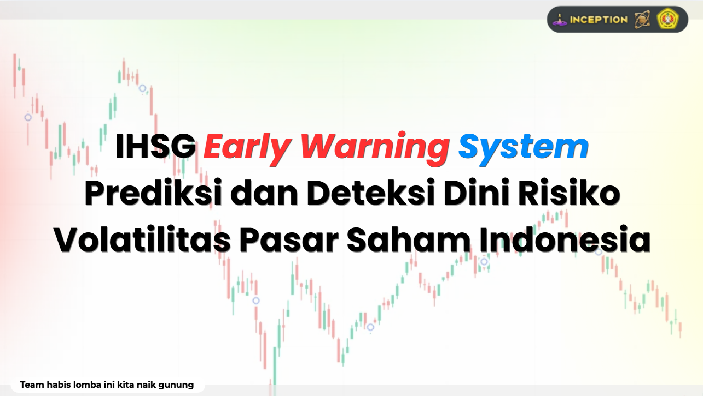

# Sistem Peringatan Dini Volatilitas IHSG


Proyek Data Science Competition oleh tim **Habis Lomba Ini Kita Naik Gunung** untuk studi kasus PT Investion. Notebook mengeksplorasi prediksi volatilitas IHSG lima hari ke depan, membentuk alarm risiko, dan menjelaskan prediksi dengan SHAP.

## Isi repositori

| File | Isi |
| --- | --- |
| `DSC_Tim_Habis Lomba Ini Kita Naik Gunung.ipynb` | Analisis data, rekayasa fitur, pemodelan, evaluasi, alarm risiko, dan interpretasi model. |
| `dataset peserta.csv` | Dataset pasar keuangan dan indikator makroekonomi yang digunakan notebook. |
| `readme.md` | Dokumentasi proyek dan cara menjalankan notebook. |

## Dataset

CSV berisi **4.266 baris dan 11 kolom**, dari **4 Januari 2010 sampai 22 Mei 2026**. Kolomnya adalah `Date`, `OIL`, `GOLD`, `USDIDR`, `SP500`, `IHSG`, `VIX`, `CPI`, `BI_rate`, `US_rate`, dan `Target_Volatilitas_Y`.

- Sebanyak **3.907 baris** memiliki target, hingga 24 Desember 2024.
- Sebanyak **359 baris** mulai 2 Januari 2025 belum memiliki target dan digunakan sebagai data uji.
- Pemeriksaan CSV tidak menemukan duplikat baris, duplikat tanggal, atau nilai kosong di kolom selain target.

Jumlah dan rentang tanggal tersebut dihitung langsung dari CSV. Target digunakan untuk tugas prediksi volatilitas lima hari ke depan; definisi persis pembentukan target tidak dapat dipastikan dari CSV saja.

## Pendekatan dan evaluasi

Notebook mencakup pemeriksaan dan pembersihan data, EDA, pembentukan 13 fitur untuk model utama, perbandingan baseline, serta interpretasi global dan lokal menggunakan SHAP. Model utama menggunakan `StandardScaler` dan `RidgeCV`; notebook juga memuat eksperimen model lain.

Evaluasi mempertahankan urutan waktu:

- **Train:** data sampai 2022, dengan lima baris terakhir dikeluarkan sebelum batas validasi.
- **Validasi:** 2023–2024.
- **Test:** mulai 2025, tanpa target yang tersedia.
- **Cross-validation:** `TimeSeriesSplit(n_splits=5, gap=5)`.
- **Walk-forward:** evaluasi tahunan 2015–2024 dengan embargo lima baris.

## Hasil yang tersimpan

Tabel berikut disalin dari output evaluasi validasi yang tersimpan dalam notebook. Angka ini **belum dihitung ulang dalam penyiapan repositori** dan bukan skor data uji.

| Model | RMSE | MAE | R² |
| --- | ---: | ---: | ---: |
| Naif rv5 | 0.00403 | 0.00297 | -0.60617 |
| EWMA | 0.00329 | 0.00258 | -0.06573 |
| HAR | 0.00329 | 0.00263 | -0.06952 |
| Ridge | 0.00322 | 0.00263 | -0.02179 |

Angka tersebut berasal dari satu periode validasi; tabel ini tidak menyajikan mean dan standar deviasi antar-fold.

## Cara menjalankan

1. Unduh atau clone repositori, lalu letakkan notebook dan `dataset peserta.csv` dalam folder yang sama.
2. Siapkan lingkungan Python. Metadata notebook mencatat **Python 3.11.9**; versi paket untuk eksekusi aslinya tidak dicatat.
3. Pasang paket yang diimpor notebook:

   ```bash
   python -m pip install numpy pandas matplotlib seaborn statsmodels lightgbm shap arch scipy scikit-learn
   ```

4. Buka notebook melalui editor yang mendukung Jupyter, misalnya VS Code dengan dukungan notebook. Pilih kernel lingkungan Python tersebut dan pastikan direktori kerja adalah folder dataset.
5. Jalankan sel secara berurutan dari awal sampai akhir. Notebook memuat eksperimen tambahan dan pencarian hiperparameter, sehingga waktu eksekusi bergantung pada perangkat.

Notebook menulis `prediksi_test_2025_2026.csv`, yang memuat prediksi dan indikator alarm risiko. File ini dihasilkan saat notebook dijalankan dan tidak disertakan sebagai data mentah.

## Reproducibility dan batasan

- Notebook memakai beberapa seed sesuai prosedur: `42`, `0`, dan `1`; tidak ada satu seed global untuk seluruh analisis.
- Versi dependency belum dikunci, sehingga instalasi di lingkungan berbeda belum menjamin hasil identik.
- Pembersihan lonjakan `USDIDR` memakai nilai hari berikutnya. Langkah ini menggunakan informasi masa depan dan perlu diperhatikan saat menilai validitas simulasi prediksi historis.
- `StandardScaler` berada di luar validasi internal `RidgeCV`, sehingga scaler belum di-fit terpisah di setiap fold internal penyetelan Ridge.
- Eksekusi notebook dari awal sampai akhir dan reproduksi metrik belum diverifikasi dalam penyiapan repositori ini. Output tersimpan tidak membuktikan bahwa seluruh sel dapat dijalankan ulang pada lingkungan baru.
